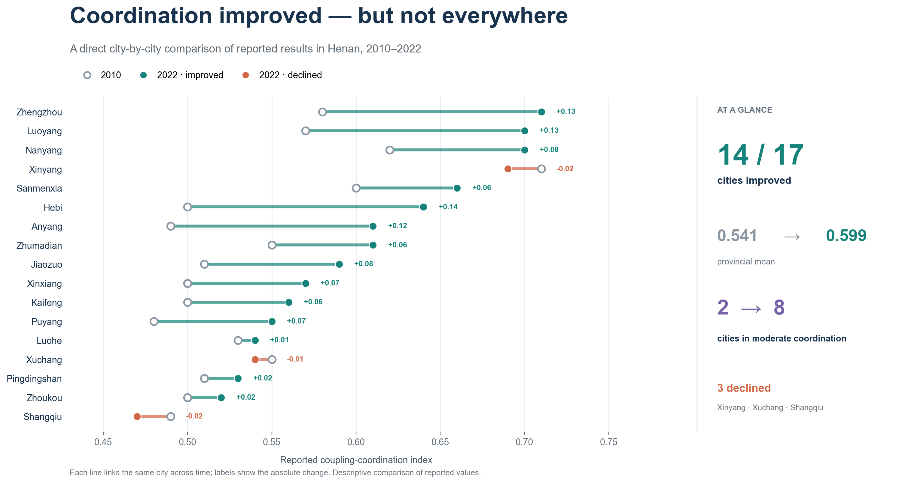
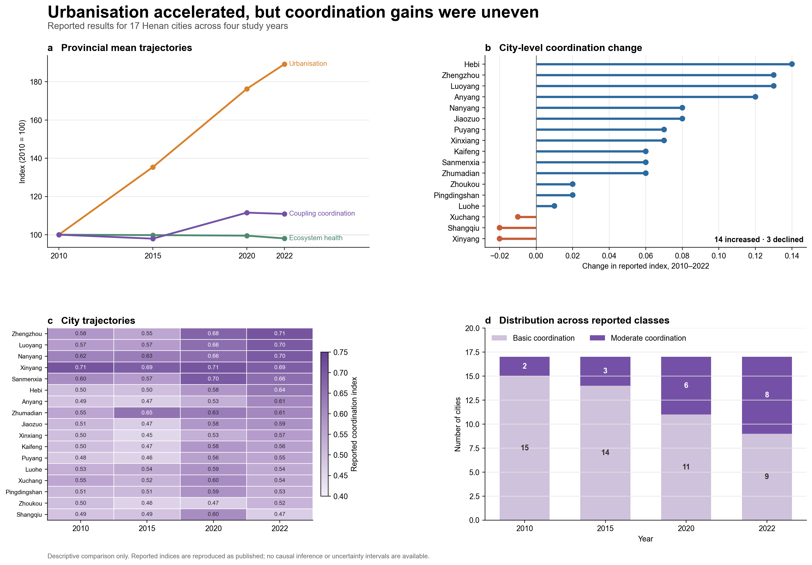
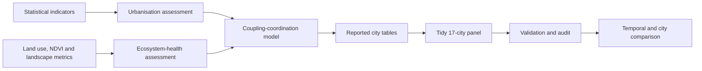

# Urbanisation and ecosystem health in Henan

**A reproducible audit and descriptive analysis of city-level coupling-coordination results from a university research competition**

[](https://github.com/JiahuiLi428/henan-urbanization-ecosystem-health/actions/workflows/tests.yml)




*Featured result — each row links the same city's reported 2010 and 2022 values, making both the direction and magnitude of change directly comparable.*

## Project at a glance

| Item | Scope |
|---|---|
| Research area | 17 prefecture-level cities in Henan Province, China |
| Study years | 2010, 2015, 2020 and 2022 |
| Systems | New urbanisation and ecosystem health |
| Original methods | Entropy weighting, VORS-related ecosystem-health assessment and coupling coordination |
| Public workflow | Table migration, integrity checks, descriptive comparison and visualisation |
| Reproducibility boundary | Reported results are reproducible; the upstream GIS and index model are not |

## Research question

Did the reported relationship between new urbanisation and ecosystem health become more coordinated across Henan cities from 2010 to 2022, and were the gains spatially even?

The source project combined statistical indicators, land-use and vegetation data, landscape-pattern measures and a coupling-coordination model. This portfolio repository narrows the claim to what the retained evidence can support: a transparent analysis of the three city-level result tables.

## Main findings



- The provincial mean of the **reported urbanisation index increased by 89.25%** between 2010 and 2022.
- The mean **reported ecosystem-health index decreased by 1.94%**, indicating that ecological conditions did not rise in parallel with urbanisation on the report's scale.
- Mean coupling coordination increased from **0.541 to 0.599**, but peaked at **0.603 in 2020** before a small decline in 2022.
- **14 of 17 cities improved** between 2010 and 2022. Xuchang, Xinyang and Shangqiu declined, contradicting the source report's statement that every city improved.
- In 2022, Zhengzhou ranked highest at **0.71**; Luoyang and Nanyang both reached **0.70**. Shangqiu ranked lowest at **0.47**.
- Using the five thresholds stated in the methods, cities in “moderate coordination” increased from **2 to 8**.

These are descriptive comparisons of reported indices. They do not identify causal effects of urbanisation, and the source study did not provide uncertainty intervals.

## Research framework



| Component | Dimensions described in the source report |
|---|---|
| New urbanisation | Population, economy, space, society and green development |
| Ecosystem health | Vitality, organisation, resilience and ecosystem services |
| Coupling coordination | Composite relationship between the two reported systems |

See [methodology and public scope](docs/methodology.md) for the interpretation boundary.

## Data audit

The portfolio deliberately preserves several source issues instead of hiding them:

- the formal result tables contain 17 cities, while the workbook and map narrative also include Jiyuan;
- the report describes a two-system equal-weight formula, while the available workbook uses three composite functions with `0.3/0.3/0.4` weights;
- the written ecosystem-health scale and reported table values do not match;
- the methods state five coordination classes, while the original maps display four;
- several narrative claims do not agree with the reported table values.

For the full reconciliation, see the [data-quality audit](docs/data_quality.md). The cleaned CSV keeps the original values and adds `_reported` to fields whose scales cannot be independently reconstructed.

## What this repository demonstrates

- extracting structured evidence from a long competition report;
- designing a tidy city-year panel with explicit provenance;
- auditing spreadsheet formulas against written methodology;
- testing completeness, ranges and classification logic;
- distinguishing reproducible results from unavailable upstream modelling;
- communicating nuanced findings without overstating causality.

## Repository structure

```text
data/processed/                  Clean 17-city × 4-year result panel
docs/                            Method, figure contract and quality audit
notebooks/                       Executed validation and analysis notebooks
outputs/charts/                  Generated PNG and editable SVG overview
outputs/maps/                    README comparison + original source rasters
scripts/                         Migration, rebuild and notebook utilities
src/                             Reusable validation and plotting code
tests/                           Automated integrity checks
```

## Run locally

```bash
python -m venv .venv
# Windows: .venv\Scripts\activate
# macOS/Linux: source .venv/bin/activate
python -m pip install -r requirements.txt
python scripts/run_analysis.py
python -m pytest
```

The original competition-map plate can optionally be rebuilt with `python scripts/make_map_comparison.py`. It is retained as source evidence rather than used as the homepage visual because the complete GIS inputs are unavailable.

Execute the notebooks from the repository root:

```bash
jupyter nbconvert --to notebook --execute --inplace notebooks/01_data_validation.ipynb
jupyter nbconvert --to notebook --execute --inplace notebooks/02_temporal_comparison.ipynb
jupyter nbconvert --to notebook --execute --inplace notebooks/03_city_comparison.ipynb
```

<details>
<summary><strong>中文简介</strong></summary>

本项目将河南省大学生土地国情调查大赛中的“河南省新型城镇化与生态系统健康耦合协调研究”整理为可复现的求职作品集。公开部分包含 2010、2015、2020 和 2022 年河南省 17 个地级市的报告结果、数据核验、时序比较、城市差异分析及英文图表。

重新核验表明：城镇化报告指数均值上升约 89.25%，生态系统健康报告指数均值下降约 1.94%，耦合协调度均值由 0.541 上升至 0.599；但并非所有城市都改善，实际为 14 个城市上升、3 个城市下降。仓库同时记录了济源市口径、模型权重、指标尺度和地图分级等原始材料中的不一致。

由于缺少完整原始指标、GIS 数据、参数说明及与正文一致的模型工作簿，本项目定位为“竞赛成果结果的可复现整理与审计”，不宣称完整复现上游城镇化、VORS 或空间耦合模型。

</details>

## License

The MIT license applies to code and documentation. The processed competition-derived dataset and original map exports are included for portfolio review; no separate reuse licence is granted for those research assets.
